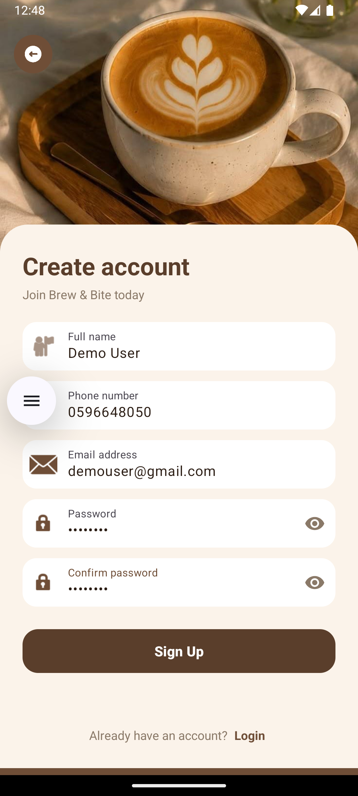
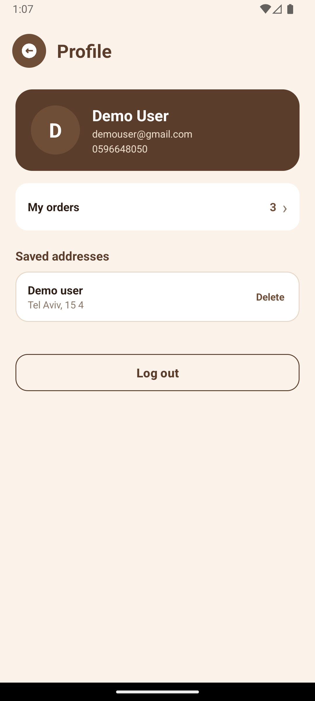

# Brew & Bite

A coffee shop ordering app for Android, built with Kotlin and Firebase.

## Features

- Email sign-up and login with "Remember me"
- Unique phone number per account
- Menu by category with search
- Product options (size, milk, espresso shots) with live price
- Per-user cart that merges identical items
- Saved delivery addresses with custom names
- Card payment UI with Luhn validation (demo, no real charges)
- Order history with live status updates
- Profile and logout

## Tech Stack

- Kotlin, Material 3
- Firebase Authentication
- Cloud Firestore
- Realtime Database

## Screenshots

### Welcome

### Sign Up

### Login

### Home

### Details

### Checkout

### Cart

### Orders

### Tracking

### Profile

## Run Locally

1. Clone the repository.
2. Create a Firebase project and add an Android app with package `com.example.shoppingcartapp`.
3. Download `google-services.json` and place it in `app/`.
4. Enable Authentication (Email/Password) and Firestore.
5. Add the products to the `products` collection.
6. Run the app from Android Studio.

## Notes

Payment is a demo: only the card brand and last 4 digits are stored, never the full number or CVV.
